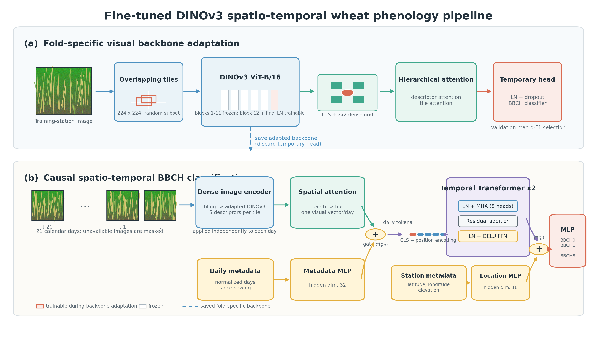

# Wheat Phenology Identifier

[](https://www.python.org/downloads/)
[](https://pytorch.org/)
[](https://huggingface.co/facebook/dinov3-vitb16-pretrain-lvd1689m)
[-purple.svg)](#reproducibility-leakage-prevention-rules)
[](#)

An end-to-end computer vision and deep learning system for **daily in-field causal wheat phenological stage identification** from stationary agricultural monitoring cameras. 

Built on the international **BBCH scale** (Biologische Bundesanstalt, Bundessortenamt und CHemische Industrie), the system integrates high-resolution spatial tiling, foundational self-supervised vision models (**Meta DINOv3**), hierarchical patch and tile attention pooling, causal temporal Transformer modeling, and gated multimodal metadata fusion.

---

## Table of Contents

- [Key Features & Architectural Highlights](#key-features-architectural-highlights)
- [System Architecture](#system-architecture)
- [Performance & Benchmark Results](#performance-benchmark-results)
- [Documentation Index](#documentation-index)
- [Repository Layout](#repository-layout)
- [BBCH Phenological Stage Progression](#bbch-phenological-stage-progression)
- [Installation & Environment Setup](#installation-environment-setup)
- [Quickstart & Execution Workflows](#quickstart-execution-workflows)
  - [1. Metadata & Station Sanity Check](#1-metadata-station-sanity-check)
  - [2. Precompute Dense DINOv3 Feature Cache](#2-precompute-dense-dinov3-feature-cache)
  - [3. Train Causal Temporal Transformer (LOSO)](#3-train-causal-temporal-transformer-loso)
  - [4. Automated Fold-Safe Backbone Fine-Tuning](#4-automated-fold-safe-backbone-fine-tuning)
  - [5. Causal Window Deployment Inference](#5-causal-window-deployment-inference)
  - [6. Dataset Quality Cleaning & In-Place Repair](#6-dataset-quality-cleaning-in-place-repair)
  - [7. Classical SIFT/RANSAC Magnification Audit](#7-classical-siftransac-magnification-audit)
- [Reproducibility & Leakage Prevention Rules](#reproducibility-leakage-prevention-rules)
- [Citation & Contact](#citation-contact)

---

## Key Features & Architectural Highlights

- **Strict Temporal Causality**: Deployment predictions for calendar day $t$ condition exclusively on visual observations and metadata from days $\le t$ (causal window $W = 21$ or $31$ days). Future imagery is strictly inaccessible; missing sensor dates are handled with causal temporal key-padding masks.
- **10X Close-Up Micro Stream Focus**: Targets the narrow field-of-view camera stream to sharply resolve millimeter-scale morphological landmarks (early tillers, spikelet differentiation, heading awn emergence, anther extrusion) while discarding uninformative sky and horizon variability.
- **Overlapping High-Resolution Tiling**: Partitions multi-megapixel raw canopy photos into $224 \times 224$ crops with a 50% overlap stride ($112$ pixels), preventing information loss at tile boundaries without resizing high-frequency plant tissues.
- **Foundational Visual Encoder (DINOv3 ViT-B/16)**: Extracts robust, self-supervised plant representations (`facebook/dinov3-vitb16-pretrain-lvd1689m`). Register tokens are explicitly stripped to prevent background artifacts from leaking into spatial representations.
- **Compact Dense Patch Descriptors**: Adaptively pools ViT spatial patch tokens into a $2 \times 2$ grid plus CLS (5 descriptors per tile), preserving intra-crop spatial layout while maintaining a compact float16 disk cache (~5.4 GB for the complete dataset).
- **Hierarchical Attention Pooling**: Cascades patch-to-tile attention (learned patch positional encodings + MLP) into tile-to-daily attention (2D grid positional embeddings + masked softmax), dynamically prioritizing salient crop organs over bare soil or shadows.
- **Gated Residual Multimodal Fusion**: Fuses days-since-sowing, weather/thermal time (cumulative Growing Degree Days, GDD), and station geographic coordinates (latitude, longitude, elevation) via separate MLPs with sigmoid-gated residual connections initialized to $0.1$. This ensures visual dominance early in training while preventing metadata memorization.
- **Hybrid Ordinal Loss**: Combines soft-target cross entropy (with 60/40 boundary label smoothing) and ordinal cumulative distribution function (CDF) distance, heavily penalizing distant stage errors while accommodating natural biological transition blur.
- **Monotonic Viterbi Post-Processing**: Enforces biologically irreversible forward trajectories ($s_t \ge s_{t-1}$) during chronological station-year decoding, eliminating transient single-day noise without altering raw network outputs.
- **Leakage-Safe Leave-One-Station-Out (LOSO)**: Partitions evaluation folds strictly by physical monitoring station across turkey test sites. When fine-tuning backbone weights, adaptation sees only the fold's training stations and validation checkpoints are selected prior to a single held-out test evaluation.

---

## System Architecture


*Figure 1: Full DINOv3 BBCH causal temporal pipeline with hierarchical patch/tile attention and gated multimodal metadata fusion. A vector PDF is available at [docs/figures/dinov3_bbch_network_pipeline.pdf](docs/figures/dinov3_bbch_network_pipeline.pdf).*

```text
High-Resolution In-Field Photo (10X Micro)
                 │
                 ▼
    Overlapping Tiling (224x224, stride 112)
                 │
                 ▼
    Frozen / Fold-Adapted DINOv3 ViT-B/16 Backbone
                 │
                 ▼  (Strip Register Tokens)
    Dense Descriptors (2x2 Spatial Patch Grid + CLS)
                 │
                 ▼
    Hierarchical Patch Attention Pooling (5 tokens -> 1 tile vector)
                 │
                 ▼
    Hierarchical Tile Attention Pooling (N tile vectors -> 1 daily vector)
                 │
                 ▼
    Daily Visual Vector (d = 768)
                 │
                 ├── Add Gated Residual MLP (Days Since Sowing, init gate = 0.1)
                 ├── Add Gated Residual MLP (Cumulative GDD, init gate = 0.1)
                 ▼
    Causal Temporal Transformer Encoder (W = 21 days, 2 layers, 8 heads, causal mask)
                 │
                 ▼
    Temporal Sequence Representation ([CLS] token, d = 512)
                 │
                 ├── Add Gated Residual MLP (Lat / Lon / Elevation, init gate = 0.1)
                 ▼
    Ordinal / Soft Cross-Entropy Classification Head
                 │
                 ▼
    7-Class BBCH Probabilities (BBCH0 ... BBCH8)
                 │
                 ▼ (Optional Inference Post-Processing)
    Monotonic Viterbi Sequence Decoder (Enforces forward progression s_t >= s_{t-1})
```

---

## Performance & Benchmark Results

### 1. Primary Model: Fold-Safe Fine-Tuned DINOv3 LOSO

Evaluated across complete held-out physical stations (2,166 unique held-out prediction days):

| Metric | Score | Agronomic Interpretation |
| :--- | :---: | :--- |
| **Exact Accuracy** | **86.38%** | Direct agreement with ground-truth BBCH stage interval. |
| **Station-Balanced Exact Accuracy** | **86.44% ± 5.16%** | Unweighted mean across held-out physical stations. |
| **Aggregate Macro-F1** | **0.8457** | Unweighted harmonic mean across all 7 phenological stages. |
| **Station-Balanced Macro-F1** | **0.8142 ± 8.85%** | Cross-station balanced macro-F1. |
| **Plus/Minus-1 Stage Accuracy** | **100.00%** | **Zero catastrophic non-adjacent errors**; all mistakes are adjacent boundary transitions. |
| **Quadratic Weighted Kappa (QWK)** | **0.9824** | High inter-rater ordinal agreement corrected for chance. |
| **Mean Absolute Stage Error (MASE)** | **0.1362** | Average prediction deviation is only ~0.14 stages. |
| **5-Day Soft Date-Window Score** | **0.9073** | Proximity score within a 5-day boundary tolerance window. |

#### Per-Class F1 Progression:
- **`BBCH0` (Emergence)**: `0.9382`
- **`BBCH1` (Leaf Development)**: `0.8978`
- **`BBCH2` (Tillering)**: `0.7602`
- **`BBCH3` (Stem Elongation)**: `0.8742`
- **`BBCH5` (Heading)**: `0.7389`
- **`BBCH6_7` (Flowering & Grain Filling)**: `0.7764`
- **`BBCH8` (Maturity / Senescence)**: `0.9344`

### 2. Paradigm Comparison Across the Repository

| Paradigm | Directory | Temporal Modeling | Visual Representation | Metadata Fusion | Key Empirical Finding |
| :--- | :--- | :--- | :--- | :--- | :--- |
| **Causal Temporal DINOv3** | [`DINOv3_BBCH/`](DINOv3_BBCH/) | 21-day Causal Transformer | Dense DINOv3 (tiled, 2x2 grid + CLS) | Gated Residual MLPs (Calendar, GDD, Lat/Lon) | **State-of-the-Art**: 86.4% exact, 0.846 F1, 100% adjacent accuracy. |
| **Single-Image PEFT Adapters** | [`Adapter_BBCH/`](Adapter_BBCH/) | None (Single frame) | DINOv3 + LoRA / AdaptFormer / Transition Prior | None (Pure visual) | Explores parameter-efficient adaptation (18k params) under 25%, 50%, and 100% label budgets. |
| **Single-Day Linear Probe** | [`DINOv3_BBCH_Linear/`](DINOv3_BBCH_Linear/) | None (Single frame) | Dense DINOv3 (tiled, fine-tuned final block) | Direct Concatenation (GDD, Lat/Lon/Elev) | Non-temporal ablation proving the essential role of temporal sequence context. |
| **Tabular + ExG Baseline** | [`Baseline_BBCH/`](Baseline_BBCH/) | 21-day Causal Rolling Statistics | Illumination-Tolerant ExG Summary Statistics | HistGradientBoosting (Weather, GDD, Calendar, Coords) | Non-deep-learning reference quantifying performance achievable without learned vision features. |
| **Historical 2D CNN** | [`archive/CNN/`](archive/CNN/) | 31-day Causal Transformer | EfficientNetV2 / ConvNeXt | Concatenated days since planting | Overfit to background soil and installation textures (train 95% vs val 65%). |
| **Historical 3D CNN** | [`archive/CNN3D/`](archive/CNN3D/) | Spatiotemporal 3D Convolutions | Raw Video Tensor $[T, C, H, W]$ | Concatenated days since planting | Memory-prohibitive; brittle balance between overfitting and underfitting. |
| **Historical DINOv2** | [`archive/DINOv2_BBCH/`](archive/DINOv2_BBCH/) | 31-day Causal Transformer | Frozen DINOv2-Base (1 vector per tile) | Early Gated Metadata | Predecessor architecture; dense DINOv3 patch grids improved morphological detail. |

---

## Documentation Index

The repository features comprehensive modular documentation under [`docs/`](docs/):

| Guide | Description |
| :--- | :--- |
| [**Project Overview**](docs/project-overview.md) | Agronomic problem definition, strict causality requirements, environmental perturbations, BBCH taxonomy, and core design rationale. |
| [**Dataset & Preprocessing**](docs/dataset-and-preprocessing.md) | Station directory hierarchy, camera selection (`AUTO`/`K1`/`K2`), 10X micro stream justification, ISO date schema, soft transition targets, and magnification verification. |
| [**DINOv3 Temporal Pipeline**](docs/dinov3-pipeline.md) | Overlapping spatial tiling ($224 \times 224$, stride 112), register token exclusion, dense 2x2 patch grids, hierarchical patch/tile attention, float16 embedding cache format, and gated residual fusion. |
| [**Training & Evaluation**](docs/training-and-evaluation.md) | Station-level Leave-One-Station-Out (LOSO) protocol, fold-safe backbone adaptation, training-only coverage filtering, hybrid ordinal CDF loss, validation checkpointing, metric definitions, and monotonic Viterbi decoding. |
| [**Baselines & Adapters**](docs/baselines-and-adapters.md) | Detailed architectures of PEFT adapters (`Adapter_BBCH`), tabular ExG baseline (`Baseline_BBCH`), single-day linear probe (`DINOv3_BBCH_Linear`), and historical CNN/3D CNN/DINOv2 archives. |
| [**Tools & Workflows**](docs/tools-and-workflows.md) | Quality inspection and in-place JPEG repair (`dataset_cleaner`), read-only SIFT/RANSAC magnification audits, distributed multi-GPU FSDP2 setup, and single-image/causal window inference. |
| [**Documentation Hub**](docs/README.md) | Central entry point and index for the modular documentation suite. |

---

## Repository Layout

```text
wheat-phenology-identifier/
├── DINOv3_BBCH/                     # Primary causal temporal DINOv3 pipeline
│   ├── configs/                     # Reproducible training configurations (YAML)
│   ├── finetune_dinov3_backbone.py  # Leakage-safe backbone adaptation (unfreezes block 11 & norm)
│   ├── finetuned_loso_runner.py     # Automated multi-stage LOSO orchestrator
│   ├── run_finetuned_loso.sh        # Shell launcher for fold-safe fine-tuning sweeps
│   ├── precompute_multiscale_embeddings.py # High-throughput dense feature cache builder
│   ├── run_multiscale_training.py   # Temporal Transformer training, validation, and evaluation
│   ├── multiscale_phenology.py      # Core PyTorch models, poolers, datasets, and loss functions
│   ├── metadata_sanity_check.py     # Pre-flight data and label discovery auditor
│   ├── distributed_runtime.py       # Distributed PyTorch FSDP2 sharded execution utilities
│   ├── infer_cached_window.py       # Causal operational inference from historical image folder
│   ├── infer_single_image.py        # Diagnostic static-image inference utility
│   └── backbone_weights.py          # Standalone image-backbone state dict loader
├── Adapter_BBCH/                    # Single-image PEFT study (LoRA, AdaptFormer, Transition Prior)
│   ├── config/                      # YAML configs for 100%, 50%, and 25% annotation budgets
│   ├── block_model.py               # DINOv3 block hooks and parallel adapter injection
│   ├── adapter_model.py             # SVD orthonormal transition prior estimator
│   └── run_adapter_training.py      # PEFT adapter training and evaluation runner
├── Baseline_BBCH/                   # Non-deep-learning tabular + Excess Green (ExG) baseline
│   ├── config.yaml                  # Multiprocessing configuration
│   └── run_metadata_exg_training.py # HistGradientBoostingClassifier with 21-day rolling stats
├── DINOv3_BBCH_Linear/              # Non-temporal single-day DINOv3 linear probe ablation
│   ├── linear_phenology.py          # Dense feature extraction + direct metadata concatenation
│   └── run_linear_training.py       # Single-day fine-tuning and evaluation runner
├── dataset_cleaner/                 # Dataset inspection, bad frame isolation, and repair
│   ├── clean_dataset.py             # JPEG repair, corrupt file detection, and side-patch blur filter
│   ├── train_image_sorter.py        # 5-fold vision ensemble trainer for 1X vs 10X reclassification
│   └── image_prediction_sorter.py   # Ensemble audit and safe move execution
├── scripts/                         # Maintenance and verification scripts
│   ├── audit_image_magnification.py # Read-only SIFT/AKAZE + RANSAC homography magnification audit
│   ├── verify_all_stations.py       # ExG landmark curve extraction (emergence, heading, harvest)
│   ├── analyze_details.py           # Flag anomalous curves and label schedule discrepancies
│   ├── detect_shifts.py             # Detect camera rotation, servicing shifts, and wind drift
│   └── xlsx2csv.py                  # Command-line utility to convert XLSX workbooks to CSV
├── labels/                          # Ground-truth milestone annotations and data tables
│   ├── labeling_bbch_iso_dates.csv  # Canonical 15-station ground truth milestone dates
│   ├── labeling_bbch_iso_dates.xlsx # Canonical annotations with field observational notes
│   └── Fenolojik_Evreler_v3.xlsx    # Initial historical field observation workbook
├── docs/                            # Modular technical documentation guides
├── archive/                         # Preserved historical experiments (CNN, CNN3D, DINOv2)
├── requirements.txt                 # Core repository Python dependencies
└── README.md                        # Central repository documentation (this file)
```

---

## BBCH Phenological Stage Progression

The system models seven active in-season stages derived from canonical field milestone dates:

| Stage Code | BBCH Numerical Interval | Biological Milestone Start | Developmental Description |
| :---: | :---: | :--- | :--- |
| **`BBCH0`** | `00–09` | `1-Sowing` | Germination to emergence; shoots breaking soil surface. |
| **`BBCH1`** | `10–19` | `2 - Emergence` | Seedling leaf emergence, expansion, and establishment. |
| **`BBCH2`** | `20–29` | `3 - Tillering` | Lateral shoot / tiller formation; canopy closure across crop rows. |
| **`BBCH3`** | `30–39` | `4 - Stem Elongation` | Jointing / internode elongation; flag leaf emergence. |
| **`BBCH5`** | `50–59` | `5 - Heading` | Inflorescence emergence; spike emerges from flag leaf sheath. |
| **`BBCH6_7`** | `60–79` | `6 - Flowering` | Anthesis (anther extrusion), followed by milk and dough caryopsis development. |
| **`BBCH8`** | `80–89` | `7 - Maturity` | Grain hardening, canopy desiccation, and harvest readiness. |
| **`OffSeason`**| — | `< 1-Sowing` or `≥ 8 - Harvest` | Pre-sowing fallow and post-harvest stubble (retained as temporal context; excluded from prediction targets via `--exclude-offseason`). |

---

## Installation & Environment Setup

### 1. Prerequisites

- Linux or macOS with Python 3.10+
- NVIDIA GPU with CUDA 11.8+ or 12.x (highly recommended for high-throughput embedding precomputation and temporal Transformer training)
- Gated Hugging Face account access for [Meta DINOv3](https://huggingface.co/facebook/dinov3-vitb16-pretrain-lvd1689m)

### 2. Setup Virtual Environment

```bash
# Clone the repository
git clone <repo-url>
cd wheat-phenology-identifier

# Create and activate virtual environment
python3 -m venv .venv
source .venv/bin/activate

# Install core repository dependencies
pip install --upgrade pip
pip install -r requirements.txt
pip install -r DINOv3_BBCH/requirements.txt
```

### 3. Authenticate Hugging Face for DINOv3

Meta's DINOv3 models are gated on Hugging Face. Accept the license terms at [facebook/dinov3-vitb16-pretrain-lvd1689m](https://huggingface.co/facebook/dinov3-vitb16-pretrain-lvd1689m) and authenticate your terminal:

```bash
huggingface-cli login
# Or set via environment variable:
export HF_TOKEN="your_hf_token_here"
```

---

## Quickstart & Execution Workflows

### 1. Metadata & Station Sanity Check

Verify that local image paths, harvest years, camera directories (`K1`/`K2`), and BBCH milestone columns align across the dataset:

```bash
python DINOv3_BBCH/metadata_sanity_check.py \
  --label-path labels/labeling_bbch_iso_dates.csv \
  --data-path data \
  --camera AUTO \
  --stream micro
```

Inspect the output to confirm that non-zero image counts exist across all 15 stations and 7 BBCH stages.

---

### 2. Precompute Dense DINOv3 Feature Cache

To enable rapid training sweeps over temporal layers, loss formulations, and metadata fusion modes without repeatedly re-running the heavy vision backbone, precompute dense patch and tile descriptors once:

```bash
python DINOv3_BBCH/precompute_multiscale_embeddings.py \
  --label-path labels/labeling_bbch_iso_dates.csv \
  --data-path data \
  --out-dir results_dinov3_bbch_cache \
  --image-backbone facebook/dinov3-vitb16-pretrain-lvd1689m \
  --camera AUTO \
  --stream micro \
  --tile-streams micro \
  --tile-pooling attention \
  --tile-size 224 \
  --tile-stride 112 \
  --max-tiles 0 \
  --dense-features \
  --dense-grid-size 2 \
  --dense-include-cls \
  --embedding-dtype float16 \
  --batch-size 256 \
  --image-batch-size 16 \
  --num-workers 16 \
  --prefetch-factor 4 \
  --device cuda
```

This generates `results_dinov3_bbch_cache/vit_embeddings.pt` (~5.4 GB float16 cache) storing 5 dense spatial descriptors per tile ($2 \times 2$ grid + CLS).

---

### 3. Train Causal Temporal Transformer (LOSO)

Train the causal temporal Transformer across all Leave-One-Station-Out folds using the precomputed cache:

```bash
python DINOv3_BBCH/run_multiscale_training.py \
  --config DINOv3_BBCH/configs/train_loso.yaml \
  --embedding-cache results_dinov3_bbch_cache/vit_embeddings.pt \
  --out-dir results_dinov3_loso \
  --device cuda
```

Or execute directly with explicit command-line hyperparameters:

```bash
python DINOv3_BBCH/run_multiscale_training.py \
  --label-path labels/labeling_bbch_iso_dates.csv \
  --data-path data \
  --out-dir results_dinov3_loso \
  --embedding-cache results_dinov3_bbch_cache/vit_embeddings.pt \
  --fold-strategy loso \
  --fold-group-by station \
  --expected-stations 15 \
  --validation-groups 2 \
  --test-groups 1 \
  --epochs 30 \
  --window-days 21 \
  --window-mode causal \
  --stream micro \
  --camera AUTO \
  --batch-size 32 \
  --temporal-model transformer \
  --temporal-aggregation cls \
  --temporal-layers 2 \
  --temporal-heads 8 \
  --temporal-norm-first \
  --loss hybrid \
  --ordinal-ce-weight 0.5 \
  --checkpoint-metric macro_f1 \
  --use-days-since-planting \
  --temporal-feature-fusion gated \
  --temporal-feature-gate-init 0.1 \
  --use-weather-metadata \
  --weather-feature-set cumulative \
  --weather-feature-gate-init 0.1 \
  --weather-cache results_dinov3_bbch_cache/meteostat_weather_cache.csv \
  --use-location-metadata \
  --location-gate-init 0.1 \
  --min-train-stage-days 8 \
  --min-train-window-coverage-days 12 \
  --exclude-offseason \
  --monotonic-decoding viterbi \
  --monotonic-advance-penalty 0.0 \
  --device cuda
```

---

### 4. Automated Fold-Safe Backbone Fine-Tuning

To perform leakage-safe fine-tuning where the final DINOv3 Transformer block and LayerNorm adapt strictly to each fold's training stations before caching:

```bash
# Execute fold-safe fine-tuning LOSO experiments using finetuned_loso configs:
bash DINOv3_BBCH/run_finetuned_loso.sh --configs default.yaml

# Or perform a dry-run to preview scheduled commands across all 15 folds:
bash DINOv3_BBCH/run_finetuned_loso.sh --configs default.yaml --dry-run
```

Experiment settings (such as `label_path`, `expected_stations`, `fold_start`, `fold_end`, `result_root`, and backbone learning rates) are configured in [`DINOv3_BBCH/configs/finetuned_loso/default.yaml`](DINOv3_BBCH/configs/finetuned_loso/default.yaml).

This automated runner executes the 3-stage protocol per fold:
1. Adapts the final backbone block on fold training stations; selects best epoch via validation macro-F1.
2. Precomputes a fold-specific dense embedding cache.
3. Trains the temporal classifier, evaluates the held-out test station once, and automatically frees the dense cache (`keep_caches: false`) to preserve storage.

---

### 5. Causal Window Deployment Inference

To predict the phenological stage for an in-field crop photo using realistic historical image discovery matching operational deployment:

```bash
python DINOv3_BBCH/infer_cached_window.py \
  --checkpoint results_dinov3_loso/temporal/run_fold_1/fold_1/best_model.pt \
  --image-path data/02.02/2015/K1/10X/02_02-2015_05_01-10_00-K1-10X.jpeg \
  --image-dir data/02.02/2015/K1/10X \
  --planting-date 2014-12-02 \
  --station-code 02.02 \
  --weather-cache results_dinov3_bbch_cache/meteostat_weather_cache.csv \
  --top-k 5 \
  --device cuda
```

The script scans `--image-dir` for preceding images within the 21-day causal window $[t - 20, \dots, t]$, masks unobserved calendar days, fuses normalized days-since-sowing and GDD, and prints top predicted stages with class probabilities.

---

### 6. Dataset Quality Cleaning & In-Place Repair

Clean corrupt, truncated, or uninformative frames across the dataset:

```bash
# In-place repair of truncated JPEGs and quarantine confirmed defective frames
python -m dataset_cleaner.clean_dataset data \
  --repair-jpeg \
  --apply \
  --mode medium \
  --workers 4
```

Defective files (empty, unreadable, overexposed white, underexposed dark, low contrast, or blurred side-patches) are moved safely to `<station>/bad_images/`. Truncated frames missing the JPEG `0xFFD9` marker are repaired in place.

---

### 7. Classical SIFT/RANSAC Magnification Audit

Perform a strictly **read-only** classical computer vision audit to verify whether 10X and 1X images are correctly sorted without moving files:

```bash
python scripts/audit_image_magnification.py \
  --data-path data \
  --station 02.03 \
  --year 2015 \
  --output magnification_audit_02_03.csv \
  --workers 4
```

Extracts SIFT keypoints, matches against nearby temporal reference images from both streams, and checks geometric homography scale factors ($s \approx 1.0$ confirms correct stream; $s \approx 0.1$ or $10.0$ flags misfiled images).

---

## Reproducibility & Leakage Prevention Rules

To preserve scientific rigor and guarantee valid real-world generalization claims, all experiments adhere to these non-negotiable principles:

1. **Station-Disjoint Grouping**: Folds must always be grouped strictly by physical monitoring station (`--fold-group-by station`, `--fold-strategy loso`). Randomly partitioning individual images or overlapping time windows produces artificial spatial leakage and invalidates generalization claims.
2. **Strict Training Isolation**: Any learned adaptation—including backbone fine-tuning, adapter updates, feature normalization statistics, or SVD transition priors—must be computed exclusively from the designated training stations of that fold.
3. **Validation-Only Model Selection**: Checkpoint selection (`best_model.pt`), early stopping, learning rate warmup, and decoding regularization penalties must be tuned exclusively on validation splits. Held-out test stations are evaluated strictly once after all hyperparameter decisions are frozen.
4. **Unfiltered Evaluation Splits**: Training-only coverage filters (`--min-train-stage-days`, `--min-train-window-coverage-days`) must never be applied to validation or test datasets. Validation and test sets must remain complete to evaluate performance under real-world sparse observation conditions.
5. **Primary vs. Secondary Metrics**: Exact Accuracy and Macro-F1 serve as primary optimization and reporting metrics. Plus/minus-1 stage accuracy and soft date-window scores ($T = 3, 5, 7$ days) provide secondary diagnostic context.

---

## Citation & Contact

If you utilize this pipeline, dataset taxonomy, or architectural components in your research, please reference the modular documentation guides under [`docs/`](docs/) and cite this repository:
- **Foundational Literature Reference**: [Automated Image Labeling for Precision Agriculture: Scaling Crop Phenology (PDF)](docs/references/Final%20Automated%20Image%20Labeling%20for%20Precision%20Agriculture%20Scaling%20Crop%20Phenology.pdf)

