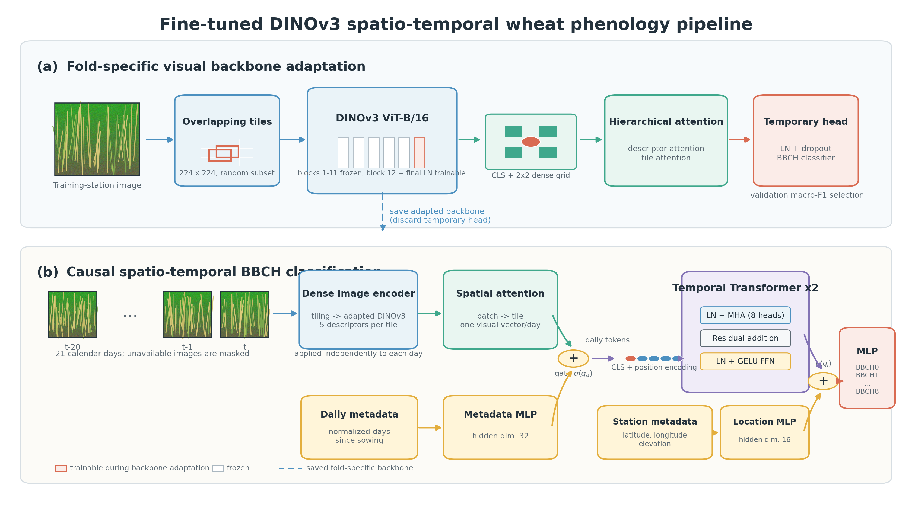
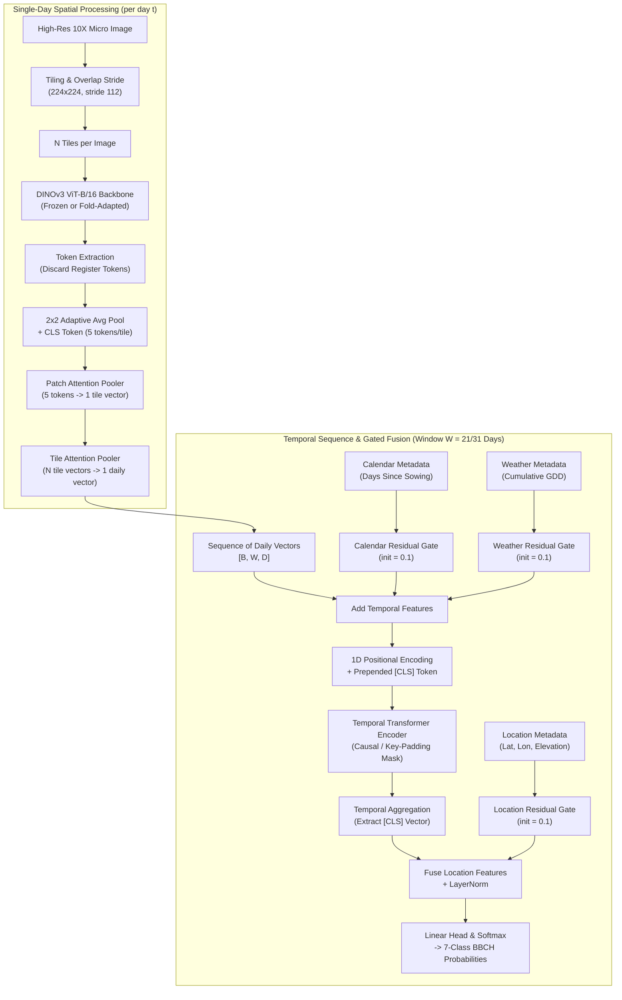

# DINOv3 BBCH Temporal Pipeline Architecture

This document describes the core temporal machine learning pipeline for daily wheat phenological stage identification in the `DINOv3_BBCH` system.

---

## 1. System Overview and Pipeline Flow

The goal of the pipeline is to predict the daily BBCH phenological stage of wheat from high-resolution, fixed-camera in-field imagery while strictly preserving temporal causality: predictions for a target day $t$ utilize visual observations from days $t - W + 1 \dots t$, but never future imagery ($t' > t$).

The architecture adopts a hierarchical spatial-temporal design:
1. **Spatial Crop Extraction**: Dividing high-resolution 10X close-up images into overlapping crops.
2. **Dense Foundation Feature Extraction**: Extracting dense spatial token representations using DINOv3 ViT-B/16 without register token interference.
3. **Hierarchical Attention Pooling**: Attending first across local patch tokens within each crop, then across spatial crops within a daily image.
4. **Causal Temporal Modeling**: Aggregating multi-week daily embedding sequences via a temporal Transformer with causal attention masks.
5. **Gated Multimodal Fusion**: Injecting calendar, weather/thermal time (GDD), and geographical metadata through learned residual gating mechanisms.
6. **Ordinal Classification**: Producing class logits mapped to ordered BBCH intervals.


*Figure 1: Full DINOv3 BBCH end-to-end network architecture. A publication-quality vector diagram is available as [PDF](figures/dinov3_bbch_network_pipeline.pdf).*



---

## 2. Image Tiling and Spatial Crop Extraction

Wheat phenological transitions (such as spikelet differentiation, heading awn emergence, and anthesis anther extrusion) involve fine-grained morphological structures. Downsampling a multi-megapixel fixed-camera field image directly to $224 \times 224$ discards these critical structural features.

### Tiling Parameters
Implemented in [precompute_multiscale_embeddings.py](../DINOv3_BBCH/precompute_multiscale_embeddings.py#L244-L272):
- **Stream**: Close-up 10X optical zoom (`--stream micro`).
- **Tile Dimensions**: $224 \times 224$ pixels (`--tile-size 224`).
- **Tile Stride**: $112$ pixels (`--tile-stride 112`), yielding a 50% spatial overlap in both horizontal and vertical axes.
- **Maximum Tile Cap**: Set via `--max-tiles 0` (0 retains all generated tiles without downsampling). For partial backbone fine-tuning, `--max-tiles 16` is used to fit within GPU VRAM budgets.

### Coordinate Grid Formulation
The grid generator `tile_boxes(width, height, tile_size, tile_stride)` computes box start coordinates along length $L$:
$$\text{starts}(L) = \begin{cases} [0], & \text{if } L \le \text{tile\_size} \\ [0, S, 2S, \dots] \cup \{L - \text{tile\_size}\}, & \text{otherwise} \end{cases}$$
where $S = \text{tile\_stride}$. Ensuring the last coordinate covers $L - \text{tile\_size}$ guarantees zero border cutoff.

> [!NOTE]
> Stride 112 yields higher spatial coverage than non-overlapping stride 224 at the expense of roughly $3\times$ to $4\times$ the tile count per image. The dense cache pipeline packs tiles across images into large batches to maintain high extraction throughput.

---

## 3. Vision Backbone: Frozen DINOv3 ViT-B/16 vs. Fold-Adapted Backbone

The primary visual feature extractor is Meta's DINOv3 Vision Transformer (`facebook/dinov3-vitb16-pretrain-lvd1689m`), loaded via Hugging Face Transformers ($4.56+$) in [multiscale_phenology.py](../DINOv3_BBCH/multiscale_phenology.py#L1964-L2034).

| Specification | DINOv3 ViT-B/16 | DINOv3 ViT-L/16 (Ablation) |
|---|---|---|
| Patch Dimensions | $16 \times 16$ | $16 \times 16$ |
| Feature Dimension ($D$) | 768 | 1024 |
| Transformer Blocks | 12 | 24 |
| Attention Heads | 12 | 16 |
| Pretraining Data | LVD-1689M | LVD-1689M |
| Native Input Resolution | $224 \times 224$ | $224 \times 224$ |

### Discarding Register Tokens
DINOv3 introduces learnable register tokens (`num_register_tokens`, typically 4) to store non-spatial background context and avoid attention artifacts. In `compact_dense_tokens` ([multiscale_phenology.py](../DINOv3_BBCH/multiscale_phenology.py#L2056-L2088)), register tokens are strictly stripped:
$$\mathbf{z}_{\text{CLS}} = \mathbf{h}_{0}, \quad \mathbf{z}_{\text{registers}} = \mathbf{h}_{1 : 1 + N_{\text{reg}}}, \quad \mathbf{z}_{\text{patches}} = \mathbf{h}_{1 + N_{\text{reg}} : 1 + N_{\text{reg}} + N_{\text{patches}}}$$
The patch tokens $\mathbf{z}_{\text{patches}}$ represent the physical $14 \times 14$ spatial grid ($196$ tokens for $224 \times 224$ with patch size 16), while $\mathbf{z}_{\text{registers}}$ are deleted.

### Frozen Reference vs. Fold-Adapted Backbone
Two modes of backbone deployment are supported:
1. **Frozen DINOv3 Backbone (Reference Standard)**:
   - Weights remain completely frozen during both cache generation and temporal classifier training.
   - Embeddings are precomputed once for all images.
   - Zero risk of backbone representation leakage across folds.
2. **Fold-Adapted Backbone (Leakage-Safe Fine-Tuning)**:
   - Implemented in [finetune_dinov3_backbone.py](../DINOv3_BBCH/finetune_dinov3_backbone.py#L191-L225).
   - Only the final Transformer block (`blocks[-1]`, block 11) and the final `LayerNorm` layers are unfrozen (`--unfreeze-last-blocks 1`, `--unfreeze-final-norm`).
   - Trained strictly on the training stations of a given fold, validated on the fold's validation stations, and never exposed to the held-out test station.
   - The adapted backbone checkpoint is saved and used to generate a fold-specific dense embedding cache.

---

## 4. Compact 2x2 Patch Grid + CLS Descriptors

Rather than collapsing each $224 \times 224$ tile into a single global vector (which causes spatial loss across fine canopies), the system retains dense spatial patch representations.

### Spatial Feature Reduction
For an input tile:
1. The $14 \times 14$ spatial patch tokens are unflattened to shape $[B, 14, 14, D]$ and permuted to $[B, D, 14, 14]$.
2. 2D adaptive average pooling (`F.adaptive_avg_pool2d`) pools the $14 \times 14$ grid into a compact $2 \times 2$ grid:
   $$\mathbf{P}_{\text{pooled}} = \text{AdaptiveAvgPool2D}(\mathbf{Z}_{\text{patch}}, \text{output\_size}=(2, 2)) \in \mathbb{R}^{B \times D \times 2 \times 2}$$
3. The tensor is flattened to 4 spatial tokens $[B, 4, D]$.
4. The $[CLS]$ token $[B, 1, D]$ is concatenated at position 0, yielding $K = 5$ tokens per tile:
   $$\mathbf{T}_{\text{tile}} = \left[ \mathbf{z}_{\text{CLS}} \,\|\, \mathbf{p}_{(0,0)} \,\|\, \mathbf{p}_{(0,1)} \,\|\, \mathbf{p}_{(1,0)} \,\|\, \mathbf{p}_{(1,1)} \right] \in \mathbb{R}^{B \times 5 \times 768}$$

```text
Tile (224x224) -> DINOv3 -> 196 Patch Tokens (14x14)
                                 │
                     Adaptive Avg Pool (2x2)
                                 │
                                 ▼
                    [ p(0,0)  p(0,1) ]
                    [ p(1,0)  p(1,1) ]  +  [ CLS ]
                                 │
                                 ▼
                     5 Descriptors per Tile (5 x 768)
```

> [!TIP]
> A $2 \times 2$ grid (5 descriptors per tile) balances representation granularity with cache footprint (5.4 GB float16 cache for the entire dataset). A $4 \times 4$ grid yields 17 descriptors per tile, requiring $3.4\times$ more storage and VRAM with marginal empirical gains.

---

## 5. Hierarchical Patch and Tile Attention Pooling

The visual representation compresses from patches to tiles, and from tiles to a daily vector via two cascading attention modules:


### Stage 1: Dense Patch Attention (`HierarchicalDenseTilePooler`)
Defined in [multiscale_phenology.py](../DINOv3_BBCH/multiscale_phenology.py#L2205-L2241):
1. **Positional Encoding**: Learnable parameter $\mathbf{E}_{\text{patch\_pos}} \in \mathbb{R}^{1 \times 1 \times 1 \times 5 \times D}$ initialized with truncated normal ($\sigma = 0.02$).
2. **Attention Scoring**:
   $$\alpha_{t, k} = \text{Linear}_{128 \to 1}\left(\text{GELU}\left(\text{Linear}_{D \to 128}\left(\text{LN}(\mathbf{T}_{t, k} + \mathbf{E}_{\text{patch\_pos}, k})\right)\right)\right)$$
3. **Weighting**:
   $$w_{t, k} = \frac{\exp(\alpha_{t, k})}{\sum_{j=1}^5 \exp(\alpha_{t, j})}, \quad \mathbf{v}_t = \sum_{k=1}^5 w_{t, k} (\mathbf{T}_{t, k} + \mathbf{E}_{\text{patch\_pos}, k}) \in \mathbb{R}^D$$

### Stage 2: 2D Tile Attention (`TileAttentionPooler`)
Defined in [multiscale_phenology.py](../DINOv3_BBCH/multiscale_phenology.py#L2146-L2203):
1. **Aspect-Ratio Grid Placement**: Given $N_{\text{tiles}}$, grid columns and rows are computed with aspect ratio $4:3$:
   $$C = \left\lceil \sqrt{N_{\text{tiles}} \times \frac{4}{3}} \right\rceil, \quad R = \left\lceil \frac{N_{\text{tiles}}}{C} \right\rceil$$
2. **2D Learnable Embeddings**: Row and column position embeddings $\mathbf{E}_{\text{row}}[r], \mathbf{E}_{\text{col}}[c] \in \mathbb{R}^D$.
3. **Masked Softmax**: For tiles exceeding actual count or invalid tiles, logits are masked to $\text{torch.finfo.min}$ in FP32 before softmax.
4. **Reduction**:
   $$\beta_t = \text{Softmax}\left(\text{MLP}_{\text{tile}}(\mathbf{v}_t + \mathbf{E}_{\text{row}}[r_t] + \mathbf{E}_{\text{col}}[c_t])\right), \quad \mathbf{x}_{\text{day}} = \sum_{t=1}^{N_{\text{tiles}}} \beta_t \mathbf{v}_t \in \mathbb{R}^D$$

---

## 6. Embedding Cache Format and Layout

To prevent repetitive, computationally prohibitive forward passes of ViT-B/16 during temporal hyperparameter sweeps, visual representations are precomputed and saved to disk.

### Execution Engine
In [precompute_multiscale_embeddings.py](../DINOv3_BBCH/precompute_multiscale_embeddings.py#L345-L484):
- Multi-threaded image loading and tiling (`--num-workers 32`).
- Asynchronous prefetching (`--prefetch-factor 4`).
- Multi-image tile packing: tiles from `--image-batch-size 16` images are flattened into a single contiguous buffer $[N_{\text{total\_tiles}}, 3, 224, 224]$, pinned in CPU memory, and transferred asynchronously to GPU in chunks of `--batch-size 256`.

### Disk Cache Structure (`vit_embeddings.pt`)
Saved as a serialized PyTorch dictionary:
```python
{
    "cache_format": "dinov3_dense_v1",       # Cache format identifier
    "feature_dim": 768,                      # 768 for ViT-B, 1024 for ViT-L
    "image_backbone": "facebook/dinov3-vitb16-pretrain-lvd1689m",
    "backbone_source": "huggingface",
    "pretrained": True,
    "embedding_dtype": "float16",            # Half precision for compact footprint
    "dense_features": {
        "enabled": True,
        "grid_size": 2,                      # 2x2 grid
        "include_cls": True,                 # Concat CLS token
        "tokens_per_tile": 5,                # 2*2 + 1 = 5
        "patch_size": 16,
        "num_register_tokens": 0,            # Register tokens stripped
        "pooling": "adaptive_avg",
    },
    "tiling": {
        "tile_streams": ["micro"],
        "tile_size": 224,
        "tile_stride": 112,
        "max_tiles": 0,
        "tile_pooling": "attention",
        "micro_tile_counts": {path: int_count, ...},
        "micro_failures": {corrupt_path: error_str, ...},
    },
    "micro": {
        "data/02.02/2015/K1/10X/02_02-...jpeg": Tensor[T, 5, 768] (float16),
        ...
    },
    "macro": {},
    "macro_aug": {},
    "micro_aug": {},
}
```

> [!IMPORTANT]
> Because DINOv3 dense cache format stores $[T, 5, 768]$ tensors while legacy DINOv2 caches stored $[T, 768]$ single-vector tiles, DINOv2 caches cannot be read by DINOv3 temporal loaders.

---

## 7. Temporal Transformer Sequence Modeling

The daily visual embedding $\mathbf{x}_{\text{day}} \in \mathbb{R}^D$ is projected to embedding dimension $D_{\text{model}} = 512$ via a projection MLP:
$$\mathbf{z}_t = \text{Dropout}\left(\text{GELU}\left(\text{Linear}\left(\text{LN}(\mathbf{x}_{\text{day}, t})\right)\right)\right) \in \mathbb{R}^{D_{\text{model}}}$$

### Causal Daily Window
- **Leading Tested Window**: $W = 21$ causal days (target day $t$ plus preceding 20 days).
- **Established Reference Window**: $W = 31$ causal days.
- **Missing Day Handling**: Fixed-camera networks frequently miss images due to hardware outages, severe weather, or transmission errors. Missing days are retained in the calendar timeline but assigned a temporal padding mask $\text{mask}[t] = \text{False}$. In the temporal Transformer, `src_key_padding_mask` prevents attention from attending to unobserved days. Nearest-image repetition is not permitted as an exact window substitute.

### Transformer Backbone Architecture
Configured via [multiscale_phenology.py](../DINOv3_BBCH/multiscale_phenology.py#L2446-L2504):
- **1D Positional Encoding**: Fixed sinusoidal encoding added across sequence positions $1 \dots W$.
- **Temporal Aggregation Token**: A learnable $[CLS]$ token $\mathbf{e}_{\text{cls}} \in \mathbb{R}^{D_{\text{model}}}$ is prepended at index 0, with mask set to $\text{True}$.
- **Layers**: 2 Transformer encoder layers (`--temporal-layers 2`).
- **Attention Heads**: 8 attention heads (`--temporal-heads 8`).
- **Feedforward Dimension**: $D_{\text{FFN}} = D_{\text{model}} \times \text{multiplier} = 512 \times 2 = 1024$ (`--temporal-ffn-multiplier 2`).
- **Activation**: GELU.
- **Dropout**: 0.2 (`--dropout 0.2`).
- **Layer Normalization**: Pre-layer norm (`--temporal-norm-first`).

After Transformer propagation, the output vector at index 0 (corresponding to the temporal $[CLS]$ token) is extracted as the aggregate representation:
$$\mathbf{r}_{\text{temporal}} = \mathbf{H}_{\text{out}}[:, 0] \in \mathbb{R}^{D_{\text{model}}}$$

---

## 8. Gated Residual Multimodal Metadata Fusion

Agricultural phenology is strongly driven by environmental and biological clocks: thermal accumulation (Growing Degree Days, GDD), elapsed time since planting, and macro-climate geography.

Naive fusion approaches concatenate scalar metadata directly with visual features. In small-sample regimes, this allows the network to overfit metadata (memorizing station coordinates or calendar days) and ignore fine visual signals. The pipeline resolves this using **Gated Residual Fusion** ([multiscale_phenology.py](../DINOv3_BBCH/multiscale_phenology.py#L2252-L2425)).

```mermaid
flowchart TD
    subgraph DailyTemporalGating["Daily-Level Residual Fusion (pre-Transformer)"]
        VisualToken["Visual Daily Token x_t<br/>[B, D_model]"]
        
        CalFeat["Days Since Sowing<br/>(Normalized scalar)"] --> CalMLP["Linear(1, 32) -> GELU<br/>-> Dropout -> Linear(32, D_model)"]
        CalMLP --> CalScale["Scale by sigmoid(gate_cal)<br/>(init = 0.1)"]
        
        WeaFeat["Cumulative GDD<br/>(Normalized scalar)"] --> WeaMLP["Linear(1, 32) -> GELU<br/>-> Dropout -> Linear(32, D_model)"]
        WeaMLP --> WeaScale["Scale by sigmoid(gate_wea)<br/>(init = 0.1)"]
        
        VisualToken --> Add1["+"]
        CalScale --> Add1
        Add1 --> Add2["+"]
        WeaScale --> Add2
        Add2 --> TransInput["Fused Token to Transformer"]
    end

    subgraph PostTemporalGating["Post-Aggregation Residual Fusion"]
        ClsRep["Temporal CLS Representation<br/>r_temporal [B, D_model]"]
        LocFeat["Lat, Lon, Elevation<br/>(Normalized dim 3)"] --> LocMLP["Linear(3, 16) -> GELU<br/>-> Dropout -> Linear(16, D_model)"]
        LocMLP --> LocScale["Scale by sigmoid(gate_loc)<br/>(init = 0.1)"]
        
        ClsRep --> AddLoc["+"]
        LocScale --> AddLoc
        AddLoc --> FinalLN["LayerNorm(D_model)"]
        FinalLN --> Head["Linear Classifier<br/>-> Logits"]
    end
```



### 1. Calendar Metadata (Days Since Sowing)
- Input: Normalized elapsed days from sowing date for each temporal position $t$.
- Architecture:
  $$\mathbf{e}_{\text{cal}, t} = \text{Linear}_{32 \to D}\left(\text{Dropout}\left(\text{GELU}\left(\text{Linear}_{1 \to 32}(d_{\text{sowing}, t})\right)\right)\right)$$
- Gating: A learnable scalar logit $w_{\text{cal}}$ initialized such that $\sigma(w_{\text{cal}}) = 0.1$:
  $$w_{\text{init}} = \ln\left(\frac{0.1}{1 - 0.1}\right) \approx -2.197$$
- Injection: $\mathbf{x}'_t = \mathbf{x}_t + \sigma(w_{\text{cal}}) \cdot \mathbf{e}_{\text{cal}, t}$.

### 2. Weather and Thermal Time Metadata (GDD)
- Feature set: Cumulative Growing Degree Days (`cumulative`, base temperature $0^\circ\text{C}$):
  $$\text{GDD}_{\text{daily}} = \max\left(0, \frac{T_{\max} + T_{\min}}{2} - T_{\text{base}}\right), \quad \text{GDD}_{\text{cum}} = \sum_{\tau = t_{\text{sowing}}}^t \text{GDD}_{\text{daily}, \tau}$$
- Cumulative GDD is integrated continuously over the astronomical calendar (not merely across days with valid camera images).
- Gating: Identical separate MLP and learnable gate $\sigma(w_{\text{weather}})$ initialized to 0.1:
  $$\mathbf{x}''_t = \mathbf{x}'_t + \sigma(w_{\text{weather}}) \cdot \mathbf{e}_{\text{weather}, t}$$

> [!NOTE]
> Cumulative GDD does not apply an input `LayerNorm` because normalising a 1D scalar across the channel axis would erase the amplitude of the thermal accumulation signal.

### 3. Geographical Location Metadata
- Input: City-family latitude, longitude, and elevation (3 normalized dimensions).
- Applied **after** temporal Transformer sequence aggregation:
  $$\mathbf{e}_{\text{loc}} = \text{Linear}_{16 \to D}\left(\text{Dropout}\left(\text{GELU}\left(\text{Linear}_{3 \to 16}(\mathbf{v}_{\text{geo}})\right)\right)\right)$$
- Residual update with learnable gate $\sigma(w_{\text{loc}})$ (initialized to 0.1) and final `LayerNorm`:
  $$\mathbf{r}_{\text{final}} = \text{LayerNorm}\left(\mathbf{r}_{\text{temporal}} + \sigma(w_{\text{loc}}) \cdot \mathbf{e}_{\text{loc}}\right)$$

### Design Rationale for 0.1 Gated Residuals
1. **Visual Dominance**: Initializing gates to 0.1 forces the visual and temporal representations to contribute 90% of the initial variance, preventing early optimization collapses where the network predicts stages purely from calendar dates.
2. **Interpretability**: The learned values of $\sigma(w_{\text{cal}})$, $\sigma(w_{\text{weather}})$, and $\sigma(w_{\text{loc}})$ are logged per epoch in `epochs.jsonl` and TensorBoard. If a gate remains near 0.1 or decays, the model found negligible utility in that metadata source under cross-station domain shift.
