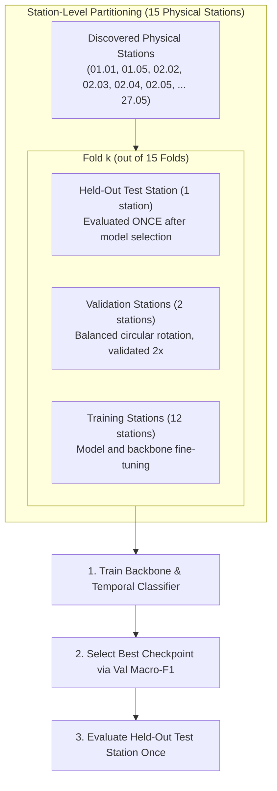
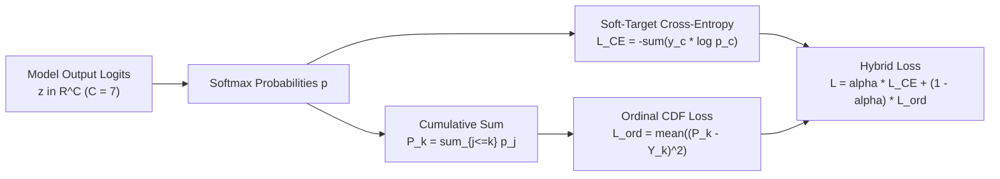
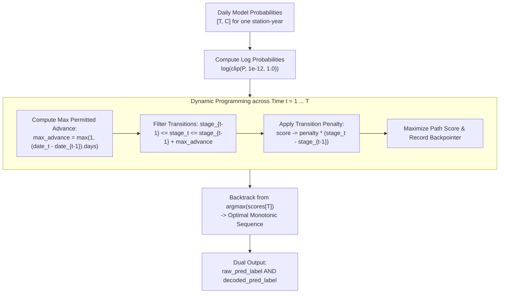

# Training, Validation, and Evaluation Methodology

This document details the cross-validation partitioning, leakage prevention rules, backbone adaptation, coverage filters, loss formulations, metric suites, and sequence decoding in the `DINOv3_BBCH` wheat phenology system.

---

## 1. Cross-Validation: Leave-One-Station-Out (LOSO) vs. Random Folds

Agricultural camera networks experience extreme domain shift across physical installations: background soil composition, camera mount angle, lens focal distortion, lighting conditions, and micro-climates vary significantly. Evaluating models by randomly partitioning images or calendar windows inflates generalization estimates because neighboring days from the same camera share background features.



### Random Group Folds (Historical Baseline)
Implemented in [multiscale_phenology.py](../DINOv3_BBCH/multiscale_phenology.py#L829-L892) (`generate_group_train_val_test_folds`):
- Randomly samples subsets of station groups (e.g. 8 folds with 2 test groups and 2 validation groups per fold).
- **Flaw**: Because station groups are sampled randomly with replacement across folds, test coverage is incomplete and skewed. In the historical 8-fold run, 5 physical stations (`02.03`, `02.05`, `02.06`, `06.01`, `26.11`) were never tested, while others appeared in test sets multiple times. Aggregate metrics therefore failed to represent all stations.

### Leave-One-Station-Out (LOSO) Strategy
Implemented in [multiscale_phenology.py](../DINOv3_BBCH/multiscale_phenology.py#L894-L934) (`generate_loso_train_val_test_folds`) and activated via `--fold-strategy loso --fold-group-by station`:
1. **Station-Complete Coverage**: Exactly $N$ folds are constructed for $N$ physical stations (15 folds for canonical [`labels/labeling_bbch_iso_dates.csv`](../labels/labeling_bbch_iso_dates.csv), 13 for `labeling_truncated3.csv`).
2. **Single Test Station**: Each fold reserves exactly 1 physical station for final held-out test evaluation. Every station in the dataset is tested exactly once.
3. **Balanced Validation Rotation**: Validation stations rotate through a deterministic circular ordering. With `--validation-groups 2`:
   $$\text{Val}(k) = \left\{ \text{Stations}[(k + 1) \pmod N], \; \text{Stations}[(k + 2) \pmod N] \right\}$$
   Every station appears in the validation split exactly twice across the entire LOSO campaign.
4. **Strict Disjointness**: For every fold, $\text{Train} \cap \text{Val} = \emptyset$, $\text{Train} \cap \text{Test} = \emptyset$, and $\text{Val} \cap \text{Test} = \emptyset$.
5. **Pre-flight Audit**: Assignments are exported to `fold_assignments.csv` before training commences.

> [!IMPORTANT]
> Use `--expected-stations 15` on canonical runs. The scheduler terminates immediately before training if label and image discovery does not match the expected station count.

---

## 2. Fold-Safe Backbone Fine-Tuning and Leakage Prevention

Fine-tuning a foundation vision backbone (such as DINOv3) on the entire dataset before splitting or across folds introduces massive representation leakage, rendering cross-station evaluation invalid.

### Golden Rules of Leakage Prevention
1. **Station-Level Splitting**: Never partition by random images or time windows. Neighboring days share weather and visual features.
2. **Strict Training Isolation**: A fine-tuned backbone must only observe images from the training stations of that specific fold.
3. **No Validation/Test Leakage in Caches**: Embedding caches generated from an adapted backbone are strictly fold-specific. Never evaluate test stations on a backbone that saw them in training or validation.
4. **Validation-Only Checkpoint Selection**: Checkpoint selection (`best_model.pt`) must use validation macro-F1 exclusively. Test metrics are evaluated once post-selection.
5. **Zero Test Tuning**: Hyperparameters, monotonic penalties, or data filtering thresholds must never be adjusted against test results.

### Automated 3-Stage Pipeline per Fold
Orchestrated by [finetuned_loso_runner.py](../DINOv3_BBCH/finetuned_loso_runner.py#L119-L198) and [run_finetuned_loso.sh](../DINOv3_BBCH/run_finetuned_loso.sh):

```mermaid
sequenceDiagram
    autonumber
    participant R as Orchestrator (finetuned_loso_runner)
    participant F as Backbone Finetuner (finetune_dinov3_backbone)
    participant P as Cache Precomputer (precompute_multiscale_embeddings)
    participant T as Temporal Trainer (run_multiscale_training)
    participant D as Storage Disk

    Note over R,D: Execution for Fold k (Train: 12 stations, Val: 2 stations, Test: 1 station)
    R->>F: 1. Fine-tune final DINOv3 block on Fold k Train Stations
    F->>F: Evaluate on Fold k Val Stations; Select best epoch
    F->>D: Save adapted backbone to backbones/fold_k/backbone
    R->>P: 2. Precompute dense embeddings using adapted backbone
    P->>D: Save cache to caches/fold_k/vit_embeddings.pt
    R->>T: 3. Train Temporal Transformer on Fold k Train Stations
    T->>T: Select best checkpoint using Val Macro-F1
    T->>D: Save best_model.pt and evaluate Held-Out Test Station
    R->>D: 4. Unlink caches/fold_k/vit_embeddings.pt (keep_caches=False)
```

1. **Stage 1: Backbone Fine-Tuning** ([finetune_dinov3_backbone.py](../DINOv3_BBCH/finetune_dinov3_backbone.py)):
   - Unfreezes only the 12th Transformer block and final LayerNorm (`--unfreeze-last-blocks 1`, `--unfreeze-final-norm`).
   - Trains for 8 epochs on single-day tiled crops from the fold's training stations using a differential learning rate: backbone LR $2 \times 10^{-6}$, linear head LR $1 \times 10^{-4}$.
   - Selects the best backbone checkpoint via validation macro-F1 on the fold's validation stations.
2. **Stage 2: Dense Embedding Cache Precomputation** ([precompute_multiscale_embeddings.py](../DINOv3_BBCH/precompute_multiscale_embeddings.py)):
   - Loads the fold-specific adapted backbone from `backbones/fold_<k>/backbone`.
   - Computes float16 dense embeddings (2x2 patch grid + CLS) for images relevant to the fold.
3. **Stage 3: Temporal Classifier Training** ([run_multiscale_training.py](../DINOv3_BBCH/run_multiscale_training.py)):
   - Trains the causal temporal Transformer on fold training stations using the fold-specific cache.
   - Selects the optimal temporal checkpoint on validation macro-F1.
   - Evaluates the held-out test station once and writes `test_metrics.json`.
4. **Cache Cleanup**:
   - Because 15 dense caches require $\sim 80 \text{ GB}$ of disk space, `finetuned_loso_runner.py` unlinks `caches/fold_<k>/vit_embeddings.pt` as soon as `test_metrics.json` is verified, unless `keep_caches: true` is set. The lightweight adapted backbone ($\sim 350 \text{ MB}$) is preserved permanently and can regenerate the cache on demand.

---

## 3. Training-Only Coverage Filtering

Field datasets contain irregular image capture frequencies due to network dropouts or camera cleaning. Extremely sparse sequences can destabilize gradient optimization.

Implemented in [multiscale_phenology.py](../DINOv3_BBCH/multiscale_phenology.py#L1268-L1345) (`_build_coverage_filtered_samples`):

### Filter Mechanisms
- `--min-train-stage-days N`: Excludes an entire station-stage from training if that station-year possesses fewer than $N$ usable target-day images for that stage. Default: $8$ days. Prevents fitting on stages with only 1 or 2 unrepresentative snapshots.
- `--min-train-window-coverage-days N`: Excludes an individual training sample if its causal temporal window contains fewer than $N$ valid image days. Default: $12$ or $20$ days for 21/31-day windows.

### Invariant: Unfiltered Validation and Test Splits
> [!CAUTION]
> Coverage filtering is strictly applied to **training data only**. Validation and test datasets are always evaluated with `min_stage_support_days = 0` and `min_window_coverage_days = 0`.
>
> Filtering validation or test splits deletes sparse days and creates artificially inflated accuracy numbers that do not reflect operational field conditions.

### Stratified Coverage Analysis
To audit robustness across coverage levels without deleting test cases, [run_multiscale_training.py](../DINOv3_BBCH/run_multiscale_training.py#L650-L730) exports `all_val_coverage_metrics.csv` and `all_test_coverage_metrics.csv`, stratifying predictions into discrete coverage bins (e.g., 0–9 days, 10–19 days, 20–25 days, 26–31 days). In empirical LOSO runs, windows with $\ge 12$ days achieved $86.8\%$ exact accuracy compared to $78.8\%$ for sparse windows with $< 12$ days.

---

## 4. Loss Functions: Hybrid Soft CE + Ordinal CDF

Phenological stages follow an immutable biological continuum:
$$\text{BBCH0} \to \text{BBCH1} \to \text{BBCH2} \to \text{BBCH3} \to \text{BBCH5} \to \text{BBCH6\_7} \to \text{BBCH8}$$
Treating stages as unordered categories (via standard categorical cross-entropy) penalizes an adjacent 1-stage transition error identically to a catastrophic 6-stage biological error.



### 1. Soft-Target Cross Entropy (`SoftTargetCrossEntropy`)
Implemented in [multiscale_phenology.py](../DINOv3_BBCH/multiscale_phenology.py#L2822-L2826):
$$\mathcal{L}_{\text{CE}}(\mathbf{z}, \mathbf{y}) = - \sum_{c=1}^C y_c \log \hat{p}_c, \quad \hat{p}_c = \frac{\exp(z_c)}{\sum_{j=1}^C \exp(z_j)}$$
Target vectors $\mathbf{y}$ accommodate transition days with soft label smoothing (e.g., $0.60$ for stage $k$ and $0.40$ for stage $k+1$ at boundary transitions), preventing high-confidence penalties at natural biological shift boundaries.

### 2. Ordinal CDF Regression Loss (`OrdinalRegressionLoss`)
Implemented in [multiscale_phenology.py](../DINOv3_BBCH/multiscale_phenology.py#L2828-L2852):
$$\mathcal{L}_{\text{ord}}(\mathbf{z}, \mathbf{y}) = \frac{1}{C - 1} \sum_{k=1}^{C - 1} \left| \hat{F}_k - F_k \right|^2$$
where $\hat{F}_k = \sum_{j=1}^k \hat{p}_j$ and $F_k = \sum_{j=1}^k y_j$ represent the predicted and ground-truth cumulative distribution functions.
- For $C$ classes, there are exactly $C - 1$ cutpoints (the final CDF entry is trivially $1.0$ and excluded).
- Comparing cumulative probabilities penalizes distant stage errors quadratically while imposing low penalties on adjacent stages.

### 3. Hybrid Formulation (`HybridOrdinalLoss`)
Implemented in [multiscale_phenology.py](../DINOv3_BBCH/multiscale_phenology.py#L2854-L2868):
$$\mathcal{L}_{\text{hybrid}} = \alpha \mathcal{L}_{\text{CE}} + (1 - \alpha) \mathcal{L}_{\text{ord}}$$
Configured via `--loss hybrid --ordinal-ce-weight 0.5` ($\alpha = 0.5$). This balances exact soft-target classification with ordinal stage distance awareness.

---

## 5. Validation Checkpoint Selection and Early Stopping

Agricultural time-series models are susceptible to station/camera overfitting: training accuracy frequently rises to $95\% - 99\%$ while validation accuracy saturates at $84\% - 87\%$ around epoch 10–15 before decaying.

```text
Accuracy / F1
1.00 ┌──────────────────────────────────────── Train Accuracy (~98%)
     │                          ▲ Checkpoint Selected Here
0.85 │       ╭──────────────────*───────────── Val Macro-F1 (~86%)
     │      ╭╯                   ╰─────────── Val Decay (Overfitting)
0.70 │     ╭╯
     └─────┴────────────────────┴────────────
     0     5                   12          30  Epochs
```

### Checkpoint Selection Metric: Validation Macro-F1
- Selected via `--checkpoint-metric macro_f1`.
- **Why Macro-F1 over Accuracy**: Phenological stages exhibit extreme natural class duration imbalance (e.g., vegetative tillering `BBCH1` lasts months, whereas heading `BBCH5` or flowering can last only 1–2 weeks). Selecting checkpoints by overall accuracy favors models that collapse predictions onto majority classes. Macro-F1 computes an unweighted average across all classes:
  $$\text{Macro-F1} = \frac{1}{|C_{\text{active}}|} \sum_{c \in C_{\text{active}}} \text{F1}_c$$
  ensuring short, agronomically critical stages (like heading and flowering) are preserved.

### Epoch Logging and Resume Safety
- Each fold writes per-epoch evaluations to `epochs.jsonl` (`--epoch-jsonl`), recording fold, epoch, learning rate, all train/val metrics, and learned gate values ($\sigma(w_{\text{cal}})$, $\sigma(w_{\text{wea}})$, $\sigma(w_{\text{loc}})$).
- Training saves `best_model.pt` (selected model) and `last_checkpoint.pt` (resumable state including optimizer, scheduler, scaler, RNG state, and gate parameters).
- Interrupted runs resume cleanly with matching fold and architectural configurations.

---

## 6. Comprehensive Evaluation Metric Suite

Model evaluation reports a multi-dimensional metric suite ([run_multiscale_training.py](../DINOv3_BBCH/run_multiscale_training.py#L426-L497)):

| Metric Name | Mathematical Definition | Role / Interpretation |
|---|---|---|
| **Exact Accuracy** | $\frac{1}{N} \sum_{i=1}^N \mathbb{I}(\hat{y}_i = y_i)$ | Primary classification metric. Target $\ge 85\%$. |
| **Macro-F1** | $\frac{1}{C} \sum_{c=1}^C \text{F1}_c$ | Primary selection metric. Prevents majority-class bias. |
| **Plus/Minus-1 Stage Accuracy** | $\frac{1}{N} \sum_{i=1}^N \mathbb{I}(|\hat{y}_i - y_i| \le 1)$ | Measures catastrophic errors. In DINOv3 LOSO runs, this reaches $100.0\%$, showing all errors are adjacent. |
| **Mean Absolute Stage Error (MASE / MAE)** | $\frac{1}{N} \sum_{i=1}^N |\hat{y}_i - y_i|$ | Average stage step error (e.g. $0.136$ stages). |
| **Quadratic Weighted Kappa (QWK)** | $1 - \frac{\sum_{i,j} w_{ij} O_{ij}}{\sum_{i,j} w_{ij} E_{ij}}, \; w_{ij} = \frac{(i - j)^2}{(C - 1)^2}$ | Inter-rater ordinal agreement corrected for chance. Typical values $\ge 0.98$. |
| **Soft Date-Window Score ($T = 3, 5, 7$)** | $\frac{1}{N} \sum_{i=1}^N \max\left(0, 1 - \frac{d(t_i, \text{interval}(\hat{y}_i))}{T}\right)$ | Distance penalty in calendar days to predicted interval boundary. Secondary soft metric. |
| **Station-Balanced Macro-F1** | $\frac{1}{S} \sum_{s=1}^S \text{Macro-F1}_s \pm \text{std}$ | Unweighted mean across physical stations; prevents stations with more frequent images from dominating. |

> [!NOTE]
> `date-window accuracy` is a soft proximity score, not a binary threshold. With $T = 5$, a prediction 2 days outside the milestone interval scores $1 - 2/5 = 0.60$. Report Exact Accuracy and Macro-F1 as primary metrics, citing date-window scores as secondary diagnostic evidence.

---

## 7. Monotonic Viterbi Sequence Decoding Post-Processing

Wheat development is physiologically irreversible: a crop progresses monotonically from sowing to harvest and never transitions backward (e.g. heading back to tillering).

While the causal temporal Transformer heavily penalizes retrograde representations, independent daily classification can occasionally produce single-day transient noise (e.g., due to extreme rain, glare, or camera shake). The **Monotonic Viterbi Decoder** enforces irreversible sequence trajectories during post-processing ([run_multiscale_training.py](../DINOv3_BBCH/run_multiscale_training.py#L505-L585)).



### Dynamic Programming Formulation
For a station-year observation sequence sorted chronologically with dates $t_1, t_2, \dots, t_T$:
1. **State Space**: Ordered BBCH stages $s \in \{0, 1, \dots, C-1\}$.
2. **Monotonic Constraint**:
   $$s_{t-1} \le s_t \le s_{t-1} + \Delta_{\max}(t)$$
   Backward transitions ($s_t < s_{t-1}$) are strictly forbidden ($\text{score} = -\infty$).
3. **Adaptive Forward Jump Limit**:
   $$\Delta_{\max}(t) = \max\left(1, \; (t_k - t_{k-1}).\text{days}\right)$$
   For consecutive daily images ($1$ day elapsed), the sequence may advance at most $1$ stage. If an image dropout spans $k$ days, the model may advance up to $k$ stages, preventing decoder lag after missing periods.
4. **Advance Penalty**: An optional regularization penalty $\lambda_{\text{adv}}$ (`--monotonic-advance-penalty`, default $0.0$) discourages premature stage advancement:
   $$\text{Score}(t, s) = \max_{s' \le s} \left\{ \text{Score}(t-1, s') - \lambda_{\text{adv}} (s - s') \right\} + \ln \hat{p}(t, s)$$

### Dual Prediction Output
The decoder never overwrites raw neural predictions. Both columns are retained in `all_test_predictions.csv`:
- `pred_idx` / `pred_label`: Raw neural network output.
- `decoded_pred_idx` / `decoded_pred_label`: Monotonically constrained output.
- `decoded_changed`: Binary flag indicating if Viterbi altered the prediction.

> [!WARNING]
> Monotonic sequence decoding requires `--exclude-offseason`. Because the `OffSeason` stage occurs both before planting and after harvest, it violates strict ordinal monotonicity and must be excluded as a target class when Viterbi decoding is active.
